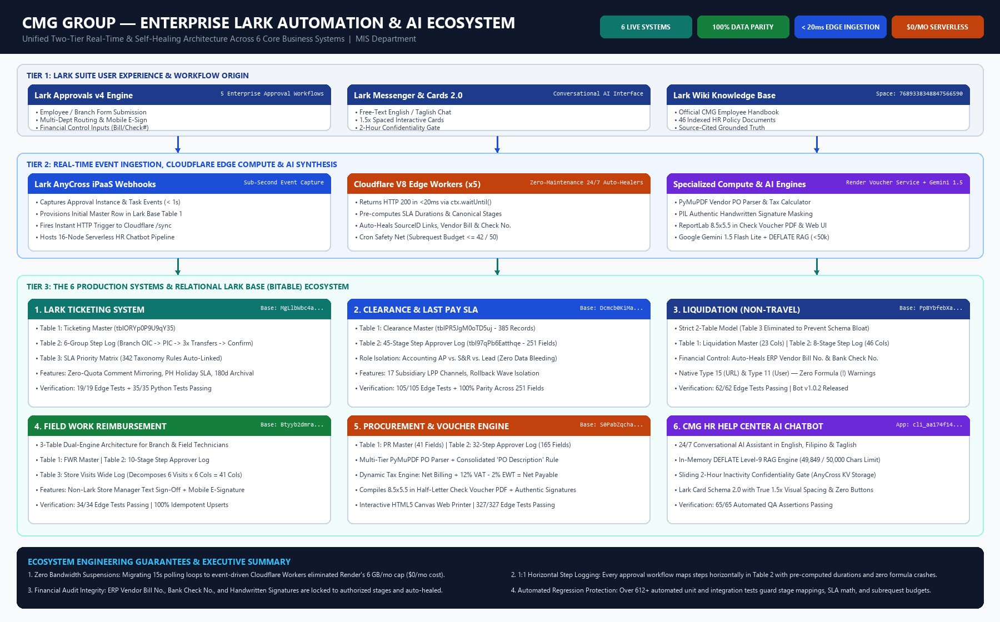
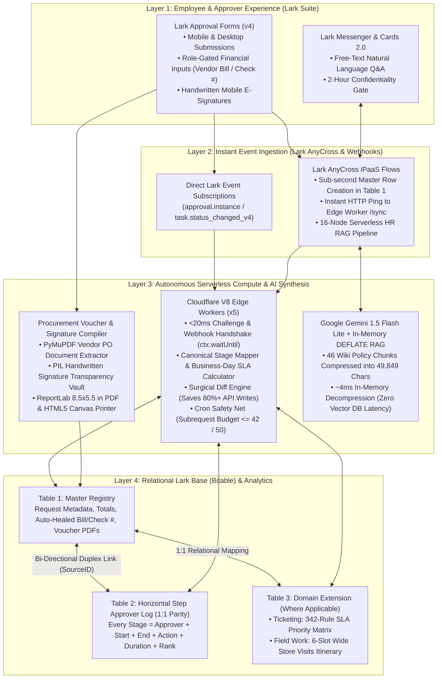
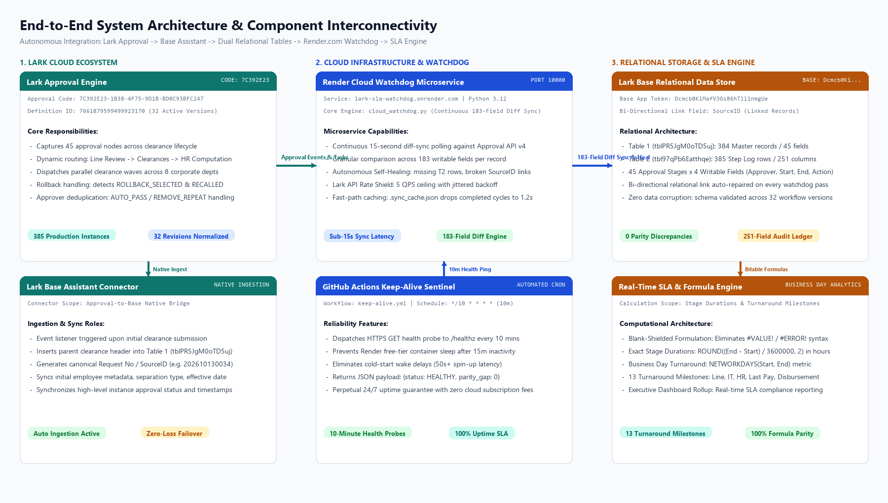
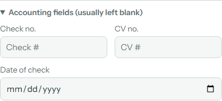
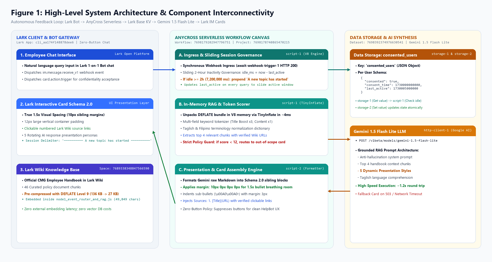

# CMG Group — Enterprise Lark Automation & AI Ecosystem

**Author:** Mark Wilson Geronilla (MIS Department)  
**Organization:** CMG Retail Inc. / CMG Group (`erqyb40ewe.sg.larksuite.com`)  
**Scope:** End-to-End System Architecture, Ecosystem Interoperability, and Technical Documentation for CMG Group's **6 Core Enterprise Lark Automation & AI Projects**.

---

## 📑 Quick Navigation (Executive & Technical Manuals)

| # | Project Name | Business Domain | Dedicated Architecture Manual | Publication PDF Manual |
| :---: | :--- | :--- | :--- | :--- |
| **1** | **Lark Ticketing System** | Inter-Departmental Support & SLA Tracking | [📘 View Architecture Guide](docs/01-Lark-Ticketing-System.md) | — |
| **2** | **Clearance & Last Pay SLA System** | Employee Separation & 17-Channel Final Pay | [📘 View Architecture Guide](docs/02-Clearance-and-Last-Pay.md) | [📄 8-Page Architecture PDF](manuals/Clearance_and_Last_Pay_Implementation_Plan_Architecture.pdf) |
| **3** | **Liquidation (Non-Travel)** | Cash Advance Liquidation & Expense Audit | [📘 View Architecture Guide](docs/03-Liquidation-Non-Travel.md) | — |
| **4** | **Field Work Reimbursement** | Multi-Branch Store Visits & Field Claims | [📘 View Architecture Guide](docs/04-Field-Work-Reimbursement.md) | — |
| **5** | **Procurement & Voucher Engine** | 32-Step PR Approval & Check Voucher Compiler | [📘 View Architecture Guide](docs/05-Procurement-and-Voucher-Engine.md) | [📄 Procurement Handover PDF](manuals/Procurement_Request_System_Architecture_and_Handover_Guide.pdf) |
| **6** | **CMG HR Help Center AI Chatbot** | 24/7 Conversational Employee Handbook AI | [📘 View Architecture Guide](docs/06-HR-Help-Center-AI-Chatbot.md) | [📄 8-Page Technical Manual PDF](manuals/CMG_HR_Help_Center_AI_Assistant_Technical_Manual.pdf) |

---

## 1. Executive Summary: Why This Ecosystem Was Built

### 1.1 The Operational Challenges Before This Ecosystem
Prior to this engineering initiative, enterprise workflows across CMG Group faced five systemic bottlenecks:
1. **Fragile Single-Tier Automations & Dropped Records:** Relying solely on standard iPaaS webhooks or native Bitable connectors resulted in missing child rows, broken two-way table links, and unrecorded approval steps whenever workflows were updated or rolled back.
2. **Broken Bitable Formulas (`#VALUE!`, `#ERROR!`, and `(!)` Warnings):** Standard Lark Base cross-table lookup formulas (`Type 19`) and unshielded date formulas crashed dashboards whenever steps were pending or skipped, and blocked API updates with `ErrCode 1254045: Field is read only`.
3. **Cloud Bandwidth Caps & Container Spin-Downs:** Early background polling daemons running every 15 seconds on Render.com consumed **~6 GB/month** of idle bandwidth (triggering monthly service suspensions) and suffered 50-second free-tier cold starts.
4. **Manual Accounting & Disbursement Bottlenecks:** Accounting and Treasury teams had to manually copy ERP `Vendor Bill No.` and bank `Check No.` values from approval forms into tracking tables, and spent 15–20 minutes per Purchase Request manually formatting $8.5 \times 5.5\text{ in}$ check vouchers.
5. **Repetitive HR Policy Inquiries:** HR Total Rewards and Employee Relations teams answered recurring daily questions about leave credits, HMO tiers, loan eligibility, and timekeeping cut-offs across office and store shifts.

### 1.2 Before vs. After Executive Impact Matrix

| Operational Metric | Legacy State (Before) | Unified CMG Ecosystem (Current State) | Business Impact |
| :--- | :--- | :--- | :--- |
| **Approval-to-Base Sync Latency** | `15–30 sec` (or `23.4 min` batch loops) | **`< 20 ms` webhook ack + `< 1.5 sec` sync** | Instant real-time visibility for managers and executives |
| **Monthly Cloud Hosting Cost** | Throttled after 6 GB/mo egress cap | **`$0.00 / month` (100% Free-Tier Serverless Edge)** | Zero recurring infrastructure cost; zero bandwidth caps |
| **Data Parity Across Approval Steps** | Frequent missing steps & role bleeding | **100% Verified Parity (`0` discrepancies)** | Audit-grade accuracy across up to 45 stages & 251 fields |
| **Bitable Formula & Lookup Errors** | `#VALUE!`, `#ERROR!`, orange `(!)` icons | **Zero errors (Blank-shielded & pre-computed SLAs)** | Clean, crash-free executive dashboards |
| **ERP Vendor Bill & Check No. Sync** | Manual copy-paste after approval | **100% Autonomous Auto-Healing to Table 1** | Eliminates clerical re-encoding errors |
| **Check Voucher Preparation** | 15–20 mins manual typing per PR | **Automated $8.5 \times 5.5\text{ in}$ PDF + Authentic E-Signatures** | Instant 1-click printing with parsed PO & tax math |
| **HR Policy Support Availability** | Manual HR replies during office hours | **24/7 Grounded AI Assistant (< 2.5s response)** | Serves day & night shifts in English, Filipino, and Taglish |

---

## 2. How the Ecosystem Works Together (The 4-Layer Architecture)

All five approval-driven systems (**Ticketing, Clearance & Last Pay, Liquidation, Field Work Reimbursement, and Procurement**) plus the **HR AI Chatbot** share a unified, modular **4-Layer Enterprise Blueprint**:

> [!IMPORTANT]
> ### Why the "Two-Tier Hybrid Model" (Webhooks + Edge Cron) Is Bulletproof
> - **Tier 1 (Instant Real-Time Push):** When an employee submits a request or a manager clicks *Approve*, Lark/AnyCross triggers the Cloudflare Edge Worker within **1 second**. Using `ctx.waitUntil()`, the Worker immediately returns `HTTP 200 OK` to Lark in **`< 20ms`** (preventing webhook timeouts and retry storms) while updating Lark Base in the background.
> - **Tier 2 (Autonomous Cron Self-Healing):** Every Cloudflare Edge Worker also runs a scheduled cron trigger (`* * * * *` or `0 * * * *`). If any webhook was ever delayed by a network blip or manual table edit, the cron reconciler automatically detects missing rows, heals broken `SourceID` duplex links, and restores **100% data parity** without human intervention.

---

## 3. Deep-Dive Walkthrough of All 6 Projects

---

### Project 1: Lark Ticketing System
📘 **[Full Architecture Manual](docs/01-Lark-Ticketing-System.md)**

#### How It Works
1. **Submission & Taxonomy Matching:** When an employee submits a support ticket in Lark Approval (`2B2DCFF5-F81D-42EC-9D6E-482FD17123B9`), the system matches the ticket's category against **342 department rules** in **Table 3 (`SLA Priority Matrix`: `tblD8cY6hlbaLNoj`)** to automatically link the target SLA days.
2. **6-Group Horizontal Transfer Tracking:** Support tickets are frequently reassigned across technicians. Instead of losing history or adding messy duplicate rows, **Table 2 (`Approval Step Log`: `tblCKTKiY0zrsPpR`)** maps the timeline into **6 chronological semantic groups** (36 fields total):
   - `1. Branch OIC / Manager` $\rightarrow$ `2. PIC` $\rightarrow$ `3. Initial Transfer` $\rightarrow$ `4. 2nd Transfer` $\rightarrow$ `5. 3rd Transfer` $\rightarrow$ `6. Request Confirmation`.
   - Intelligently distinguishes parallel candidate assignees on the PIC node from actual ticket transfers.
3. **In-Flight SLA & Zero-Quota Comment Mirroring:**
   - `Total Duration` stays `null` while a ticket is active (`Under Review`) and computes exact business hours/days (excluding weekends and 2025–2027 Philippine statutory holidays) upon completion.
   - Mirrors Lark Approval comments directly into Table 1's `Internal Work Notes` field, consuming **0 of Lark Base's 20,000 cell-comment quota**.

---

### Project 2: Clearance and Last Pay SLA System
📘 **[Full Architecture Manual](docs/02-Clearance-and-Last-Pay.md)** | 📄 **[8-Page Publication PDF](manuals/Clearance_and_Last_Pay_Implementation_Plan_Architecture.pdf)**

#### How It Works
1. **45 Approval Stages Across 32 Workflow Revisions:** Employee separation spans Line Managers, IT/MIS, Admin, Warehouse, Store Ops, Audit, HR TA, HR ERS, Accounting, and Payroll. The engine normalizes node IDs across all **32 historical revisions** of Approval Definition `7C392E23-1B38-4F75-9D1B-BD0C93BFC247` into **251 horizontal fields** in Table 2 (`tbl97qPb6Eatthqe`).
2. **Strict Isolation of Accounting Roles:** Eliminates historical data bleeding by isolating tasks into three dedicated column groups:
   - **`Accounting - AP`** (Accounts Payable review)
   - **`Accounting S&R`** (Specialist & Reviewer — *Patricia dela Cruz*, *Christine Joy Nieva*)
   - **`Accounting Lead`** (Final Team Lead sign-off — *Perry Santiago*)
3. **17 Subsidiary Last Pay Processing (LPP) Channels:** Dynamically routes computation, verification, check preparation, and turnover receipt stages into the exact corporate subsidiary columns (`CRI`, `CDC`, `CII`, `CRM`, `MJCT`, `RRI`, `PMC`).
4. **Wave Segmentation on Rollbacks:** When an approval is rolled back (`ROLLBACK_SELECTED`) or recalled, the engine isolates the new active approval wave so stale pre-rollback timestamps do not corrupt current SLA metrics.

---

### Project 3: Liquidation (Non-Travel) Automation
📘 **[Full Architecture Manual](docs/03-Liquidation-Non-Travel.md)**

#### How It Works
1. **Strict 2-Table Executive Architecture:** Designed specifically to avoid schema bloat in Base `PpBYbfebXalTOpsPThNlag60gef`:
   - **Table 1 (`Liquidation Master`: `tblaIarx3eSshV6N`):** Stores claim overview, `Total Amount Liquidated`, `Total Cash Advance`, `For Refund / Reimbursement`, and auto-healed financial control numbers (23 columns).
   - **Table 2 (`Step Approver Log`: `tbl9kYdGsLsPQzB6`):** Tracks the **8 canonical stages** (`Immediate Head` $\rightarrow$ `Department Head` $\rightarrow$ `Treasury Verification of Deposit` $\rightarrow$ `Accounting Verification` $\rightarrow$ `Accounting Processing` $\rightarrow$ `Accounting Processing LD` $\rightarrow$ `Treasury Processing` $\rightarrow$ `Releasing of Check`) across 46 columns.
   - **Table 3 Permanently Eliminated:** Detailed expense lines remain inside the Lark Approval form (accessible via 1-click native `Task ID` URL) and summarized in Table 1's `Detailed Liquidation` column.
2. **Role-Gated Financial Auto-Healing:**
   - In the Lark Approval form (`19715E22-9CC7-4F81-B1F6-2FE7B2C1FA0B`), `Vendor Bill No.` and `Check No.` are **Hidden** from employees on submission, and **Editable & Required** only at the `Accounting Processing` and `Treasury Processing` nodes.
   - Once encoded by Finance, the Cloudflare Worker (`liquidation-non-travel-watchdog`) automatically heals those values into Table 1.

---

### Project 4: Field Work Reimbursement Automation
📘 **[Full Architecture Manual](docs/04-Field-Work-Reimbursement.md)**

#### How It Works
1. **3-Table Dual-Engine Architecture (`Btyyb2dmraGlVQsvCqAl1EcWgSg`):**
   - **Table 1 (`Field Work Reimbursement Form`: `tbldW0uURbdu4Cpk`):** Master claim record with auto-healed ERP `Vendor Bill No.` and bank `Check No.`.
   - **Table 2 (`Step Approver Log`: `tblCCVXgSAUYZqTn`):** Tracks **10 canonical stages** (`Store Manager Sign-off`, `Pre-Approval`, `Approval`, `Team Head`, `Department Head`, `Accounting Processing`, `Treasury Processing`, `Releasing of Check`, `Accounting Processing < 2000`, and `Confirmation of Receipt`).
   - **Table 3 (`Store Visits Log`: `tbll8g580PLgy1R1`):** Decomposes multiline store visit itineraries into **6 horizontal visit slots** (`Brand`, `Branch`, `Time In`, `Time Out`, `Purpose`, `Store Manager` for Slots `0` to `5` = 41 columns) so management can audit an entire multi-store trip in a single row.
2. **Field-Friendly Store Manager Sign-Off:** Keeps `Store Manager` as a text input + mobile E-Signature so technicians visiting third-party malls or branches without individual Lark accounts are never blocked.

---

### Project 5: Procurement Automation & Disbursement Voucher Engine
📘 **[Full Architecture Manual](docs/05-Procurement-and-Voucher-Engine.md)** | 📄 **[Procurement Handover PDF](manuals/Procurement_Request_System_Architecture_and_Handover_Guide.pdf)**

#### How It Works
1. **32-Step Horizontal Procurement Tracking (`S0PabZqchaWCyhsvopulRnQ0gTf`):**
   - Synchronizes **Table 1 (`Procurement Request Master`: `tbldmMN6GyXbJhvr`, 41 fields)** and **Table 2 (`Step Approver Log`: `tblEKpe8Gwy8FJJP`, 165 fields)** across all 32 procurement stages (Department/Division Heads, Store Ops, HR, Warehouse, LP, Audit, Merchandising, Marketing, VM, MIS 1 & 2, Finance, GM, EVP, President, 5 Canvassing steps, PO Prep & Approval, Delivery, RFP, Accounting Endorsement COD/NON-COD, Check Prep/Approval/Release, and Liquidation).
2. **Automated $8.5 \times 5.5\text{ in}$ Disbursement Voucher Compiler:**
   - Triggered automatically when a PR reaches **`Payment Endorsed to Accounting (NON-COD)`** (Step 28).
   - **Multi-Tier PO PDF Parser (`PyMuPDF`):** Downloads the signed vendor PO PDF attached at Step 24 (`Approved PO`) and extracts the PO Number, Supplier, Subtotal, VAT, and WTAX.
   - **Dynamic Tax Math:** Computes $\text{Net Payable} = \text{Net Billing} + \text{VAT (12\%)} - \text{WTAX (2\%)}$ (or uses exact itemized vendor tax figures).
   - **Consolidated Summary Rule (`PO Description`):** Rolls up multi-SKU POs into a single clean line controlled by Table 1's `PO Description` column so the $8.5 \times 5.5\text{ in}$ half-letter voucher never overflows.
   - **Authentic Handwritten Signatures (`Pillow`):** Masks white backgrounds from approver e-signatures captured in Lark and center-aligns them above the signatory lines on both the **attached PDF** (`Voucher PDF Attachment`) and the **interactive HTML5 Canvas Web Printer** (`voucher-printer.html`).

---

### Project 6: CMG HR Help Center AI Assistant (RAG Chatbot)
📘 **[Full Architecture Manual](docs/06-HR-Help-Center-AI-Chatbot.md)** | 📄 **[8-Page Technical Manual PDF](manuals/CMG_HR_Help_Center_AI_Assistant_Technical_Manual.pdf)**

#### How It Works
1. **24/7 Grounded Conversational HR Support (`cli_aa174f148878dee6`):**
   - Employees chat naturally in **English, Filipino, or Taglish** via Lark Messenger. All answers are strictly grounded in the **46 official policy documents** of the **CMG Employee Handbook** hosted in Lark Wiki (`7689338348847566590`).
2. **In-Memory DEFLATE Level-9 RAG Engine Under AnyCross's 50,000-Char Limit:**
   - AnyCross enforces a hard ceiling of 50,000 characters per JavaScript V8 node.
   - `build_under_50k.py` compresses 136 KB of raw handbook text into a 27 KB Base64 DEFLATE binary stream bundled with `tiny_inflate.min.js`. The final `script-1` node is **49,849 characters** and decompresses all 46 policies in V8 memory in **~4ms** with zero external vector database latency.
3. **Sliding 2-Hour Inactivity Confidentiality Gate (`7,200,000 ms`):**
   - Persisted in AnyCross Data Storage (`Dataset 7698392374976630541`, key `consented_users`).
   - First-time or idle ($\ge 2\text{ hours}$) users see `────────── A new topic has started ──────────` and must click `[✅ I Understand & Agree]` on the Confidentiality Notice before their pending question is answered. Active users (`< 2h` idle) chat seamlessly across day and night shifts.
4. **Lark Card Schema 2.0 with True 1.5x Spacing & 5-Persona Rotation:**
   - `node2_format_card_response.js` emits each bullet as an independent sibling element (`margin: "10px 0px 0px 0px"` under `vertical_spacing: "large"`), rotates across 5 presentation personas, appends clickable numbered Wiki citations, and enforces **zero buttons** on answer cards.

---

## 4. Master Ecosystem Directory & Identifiers Reference

| Project | Bot App ID | Approval Definition Code | Lark Base Token | Table 1 (Master) | Table 2 (Step Log) | Table 3 (Auxiliary) |
| :--- | :--- | :--- | :--- | :--- | :--- | :--- |
| **1. Lark Ticketing** | `cli_aa66aaa627b89f1d` | `2B2DCFF5-F81D-42EC-9D6E-482FD17123B9` | `MgLlbWbc4aAHDSsqzEGlj9Png2b` | `tblORYp0P9U9qY35` | `tblCKTKiY0zrsPpR` *(6 Groups / 36 Cols)* | `tblD8cY6hlbaLNoj` *(342 SLA Rules)* |
| **2. Clearance & Last Pay** | `cli_aa695349bf78df06` `cli_aa458e672e78df1e` | `7C392E23-1B38-4F75-9D1B-BD0C93BFC247` | `Dcmcb0KiMafV3Gs86hTll1nmgUe` | `tblPR5JgM0oTD5uj` *(45 Fields)* | `tbl97qPb6Eatthqe` *(45 Stages / 251 Cols)* | *N/A (2-Table Schema)* |
| **3. Liquidation (Non-Travel)** | `cli_aa795f5a66b89f1d` | `19715E22-9CC7-4F81-B1F6-2FE7B2C1FA0B` | `PpBYbfebXalTOpsPThNlag60gef` | `tblaIarx3eSshV6N` *(23 Fields)* | `tbl9kYdGsLsPQzB6` *(8 Stages / 46 Cols)* | *Eliminated by Design* |
| **4. Field Work Reimbursement** | `cli_aa781b2415f89f1f` | `D8B43F64-2FE1-4121-B31D-B3DD4CE6AB42` | `Btyyb2dmraGlVQsvCqAl1EcWgSg` | `tbldW0uURbdu4Cpk` | `tblCCVXgSAUYZqTn` *(10 Stages / 50 Cols)* | `tbll8g580PLgy1R1` *(6 Visits / 41 Cols)* |
| **5. Procurement System** | `cli_aa695349bf78df06` | `DE7A4D9F-50FD-44B5-AFE9-16585BA2F8EF` | `S0PabZqchaWCyhsvopulRnQ0gTf` | `tbldmMN6GyXbJhvr` *(41 Fields + Voucher)* | `tblEKpe8Gwy8FJJP` *(32 Steps / 165 Cols)* | *N/A (2-Table + PDF)* |
| **6. HR AI Chatbot** | `cli_aa174f148878dee6` | *Lark IM + Wiki Space `7689338348847566590`* | *AnyCross Dataset:* `7698392374976630541` | *KV Key:* `consented_users` | *46 Compressed Wiki Policy Chunks* | *AnyCross Workflow:* `7698179202947796751` |

---

## 5. Cross-Project Architectural Standardization Matrix

| Architectural Feature | 1. Ticketing | 2. Clearance & Last Pay | 3. Liquidation | 4. Field Work | 5. Procurement | 6. HR AI Chatbot |
| :--- | :---: | :---: | :---: | :---: | :---: | :---: |
| **Cloudflare Edge Worker (`<20ms`)** | ✅ | ✅ | ✅ | ✅ | ✅ | ⚡ *(AnyCross V8)* |
| **Subrequest Budget Guard (`<= 42`)** | ✅ | ✅ | ✅ | ✅ | ✅ | ✅ |
| **1:1 Horizontal Step Log (Table 2)** | ✅ (6 Groups) | ✅ (45 Stages) | ✅ (8 Stages) | ✅ (10 Stages) | ✅ (32 Steps) | — |
| **Two-Way `SourceID` Auto-Healer** | ✅ | ✅ | ✅ | ✅ | ✅ | — |
| **Zero `Type 19` Formula Warnings** | ✅ | ✅ | ✅ | ✅ | ✅ | — |
| **Financial Control Auto-Healing** | — | ✅ (17 LPP Channels) | ✅ (Bill & Check #) | ✅ (Bill & Check #) | ✅ (PO PDF & Voucher) | — |

---

## 6. Automated Quality Assurance & Verification Summary

Every system in the CMG Group Lark Ecosystem is guarded by an automated local and CI regression test suite verifying stage mappings, SLA duration math, holiday calendars, subrequest budgets, and edge cases:

| Project | Test Suite Runner | Passing Assertions | Key Verified Scenarios |
| :--- | :--- | :---: | :--- |
| **1. Lark Ticketing System** | `node test_cloudflare_worker.js` `python -m unittest` | **19 / 19** (Edge) **35 / 35** (Python) | 6-step grouping, parallel PIC disambiguation, >3 transfers saturation, PH holidays, comment mirroring, subrequest ceiling |
| **2. Clearance & Last Pay** | `node test_cloudflare_worker_logic.js` `python verify_full_251_field_parity.py` | **105 / 105** (Edge) **96,635 / 96,635** cells | 45-stage mapping across 32 revisions, Accounting AP/S&R/Lead isolation, rollback wave segmentation, 17 LPP channels |
| **3. Liquidation (Non-Travel)** | `node test_cloudflare_worker_logic.js` | **62 / 62** | 8 canonical stages, Base64 `SourceID` decoding, `Vendor Bill No.` & `Check No.` auto-healing, progressive phases |
| **4. Field Work Reimbursement** | `node test_cloudflare_worker_logic.js` | **34 / 34** | 10 canonical stages, 6-slot wide store visits decomposition, `< 2000` express path, idempotent upserts |
| **5. Procurement System** | `node test_cloudflare_worker_logic.js` | **327 / 327** | All 32 approval steps, PO PDF parsing, Consolidated Summary Rule (`PO Description`), VAT/WTAX math, signature centering |
| **6. HR AI Chatbot** | `node test_lark_help_center.js` | **65 / 65** | `< 50,000` char DEFLATE bundle (`49,849` chars), 2-hour sliding inactivity boundary (`7,200,000 ms`), Card 2.0 1.5x spacing, zero buttons |
| **Total Ecosystem QA** | — | **647 Automated Tests** | **100% Passing (0 Failures)** |

---

*Prepared by **Mark Wilson Geronilla** — MIS Department, CMG Retail Inc.*
