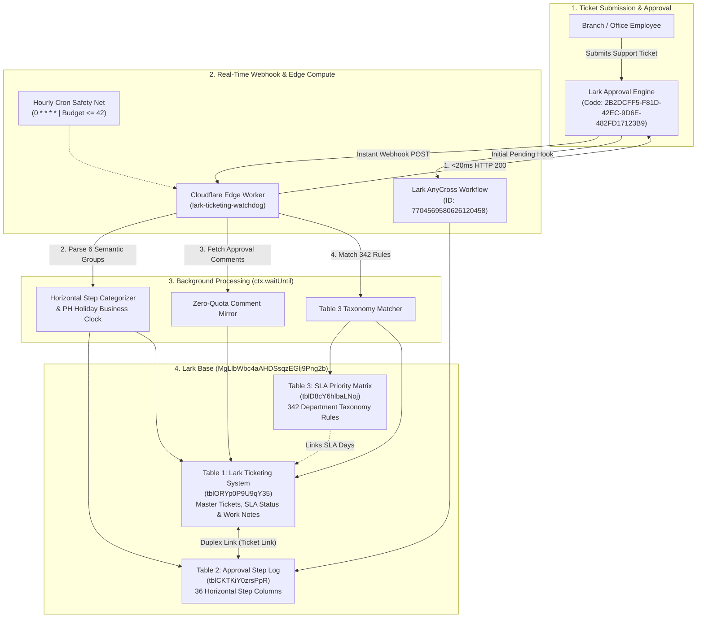

# 1. Lark Ticketing System — Architecture & Operations Manual

[⬅️ Back to Master Ecosystem Overview](../README.md)

---

## 1. Executive Summary (For Management)

The **Lark Ticketing System Automation Engine** powers cross-departmental support and service requests across CMG Group (MIS, Store Operations, Warehouse, E-Commerce, Purchasing, Store Development, and Audit).

### Business Problems Solved
- **Ticket Reassignment Blind Spots:** Previously, when support tickets were transferred between technicians or across departments, standard trackers overwrote the original PIC or lost the intermediate transfer history.
- **Unmapped SLA Deadlines:** With 342 distinct support request categories across departments, manually assigning SLA target days was error-prone.
- **Bitable Cell Comment Quota Exhaustion:** Lark Base enforces a strict 20,000 cell-comment limit per table; native comments risked hitting a hard ceiling.
- **Cloud Bandwidth Throttling:** Continuous 15-second polling on Render.com consumed ~6 GB/month of idle egress traffic.

### Key Results Achieved
- **6-Stage Horizontal Transfer Engine:** Captures the full chronological lifecycle (`Branch OIC / Manager` $\rightarrow$ `PIC` $\rightarrow$ `Initial Transfer` $\rightarrow$ `2nd Transfer` $\rightarrow$ `3rd Transfer` $\rightarrow$ `Request Confirmation`) in a single row per ticket.
- **342-Rule SLA Priority Matrix Auto-Link:** Automatically matches incoming tickets against Table 3 (`tblD8cY6hlbaLNoj`) to assign `Taxonomy Rule` and `Rule SLA Days`.
- **Zero-Quota Comment Mirroring:** Mirrors Lark Approval discussion threads directly into Table 1's `Internal Work Notes` text column (`0 / 20,000` cell comments consumed).
- **100% Free-Tier Cloudflare Edge Worker:** Responds to Lark webhooks in `< 20ms` (`ctx.waitUntil`) with an hourly safety-net cron (`SUBREQUEST_BUDGET = 42`).

---

## 2. System Architecture & Data Flow

---

## 3. Master System Identifiers

| Component | Identifier / Token | Purpose |
| :--- | :--- | :--- |
| **Lark Bot App ID** | `cli_aa66aaa627b89f1d` | Authenticated bot for Approval v4 & Bitable v1 APIs |
| **Lark Base Token** | `MgLlbWbc4aAHDSsqzEGlj9Png2b` | Master Ticketing Bitable workspace |
| **Table 1 ID** | `tblORYp0P9U9qY35` | `Lark Ticketing System` (Master ticket records & SLA tracking) |
| **Table 2 ID** | `tblCKTKiY0zrsPpR` | `Approval Step Log` (6 horizontal semantic groups = 36 step fields) |
| **Table 3 ID** | `tblD8cY6hlbaLNoj` | `SLA Priority Matrix` (342 department taxonomy & SLA target rules) |
| **Approval Definition** | `2B2DCFF5-F81D-42EC-9D6E-482FD17123B9` | Lark Approval workflow definition |
| **AnyCross Workflow** | `7704569580626120458` | `Lark Ticketing System Sync` real-time ingestion flow |

---

## 4. Table 2 Schema: The 6 Horizontal Semantic Groups

Each ticket row in Table 2 (`tblCKTKiY0zrsPpR`) tracks **36 structured fields** across 6 chronological groups, plus global headers (`Request No.`, `Approval Instance Code`, `Overall Ticket Status`, `Current Stage`, `Total Duration`, `Ticket Link`):

| Group Rank | Semantic Stage Name | Business Meaning & Edge Logic | Tracked Columns (x6 per Stage) |
| :---: | :--- | :--- | :--- |
| **1** | **Branch OIC / Manager** | Immediate supervisor or Branch OIC endorsement | `Approver`, `Start`, `End`, `Action`, `Duration`, `Rank` |
| **2** | **PIC** | Primary Person-in-Charge assigned to resolve the ticket (parallel candidates ignored unless acting) | `Approver`, `Start`, `End`, `Action`, `Duration`, `Rank` |
| **3** | **Initial Transfer** | 1st ticket reassignment / transfer recipient | `Approver`, `Start`, `End`, `Action`, `Duration`, `Rank` |
| **4** | **2nd Transfer** | 2nd ticket reassignment recipient | `Approver`, `Start`, `End`, `Action`, `Duration`, `Rank` |
| **5** | **3rd Transfer** | 3rd+ ticket reassignment recipient (safely saturates at 3 without index overflow) | `Approver`, `Start`, `End`, `Action`, `Duration`, `Rank` |
| **6** | **Request Confirmation** | Final requester sign-off confirming resolution | `Approver`, `Start`, `End`, `Action`, `Duration`, `Rank` |

---

## 5. Key Engineering Highlights

1. **In-Flight Duration Guard (`null` While Active):**
   - While a ticket is `Under Review`, `Total Duration` remains `null` so unfinished tickets never pollute average resolution time metrics. Once a ticket reaches a terminal state (`Approved`, `Rejected`, `Canceled`), the engine calculates the exact business duration excluding weekends and Philippine statutory holidays (2025–2027).
2. **Parallel Candidate vs. Transfer Disambiguation:**
   - When a PIC node has multiple candidate assignees in a user group, the parser identifies who actually claimed/acted on the task and does **not** falsely classify unchosen parallel candidates as transfers.
3. **180-Day Rolling Archival & Optional Neon PostgreSQL Sync:**
   - Completed tickets older than 180 days can be automatically migrated to an archive Base (`ARCHIVE_BASE_ID`), and analytics snapshots can be streamed to Neon Serverless PostgreSQL using 2 batched HTTP subrequests.
4. **Automated Test Coverage:**
   - Verified by **19/19 Cloudflare Edge unit tests** (`test_cloudflare_worker.js`) and **35/35 Python unit tests** (`test_watchdog.py`, `test_views_hygiene.py`).
