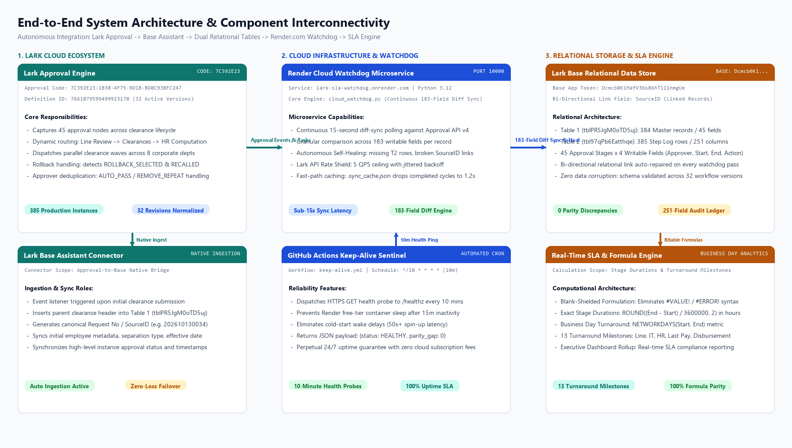
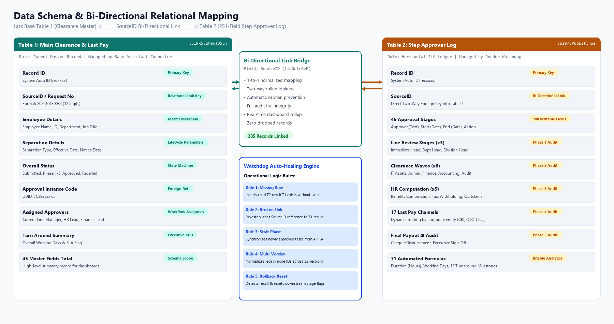
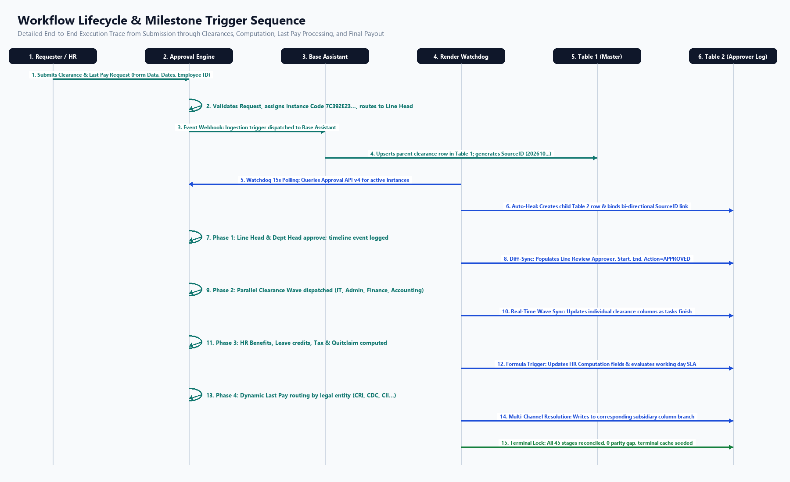
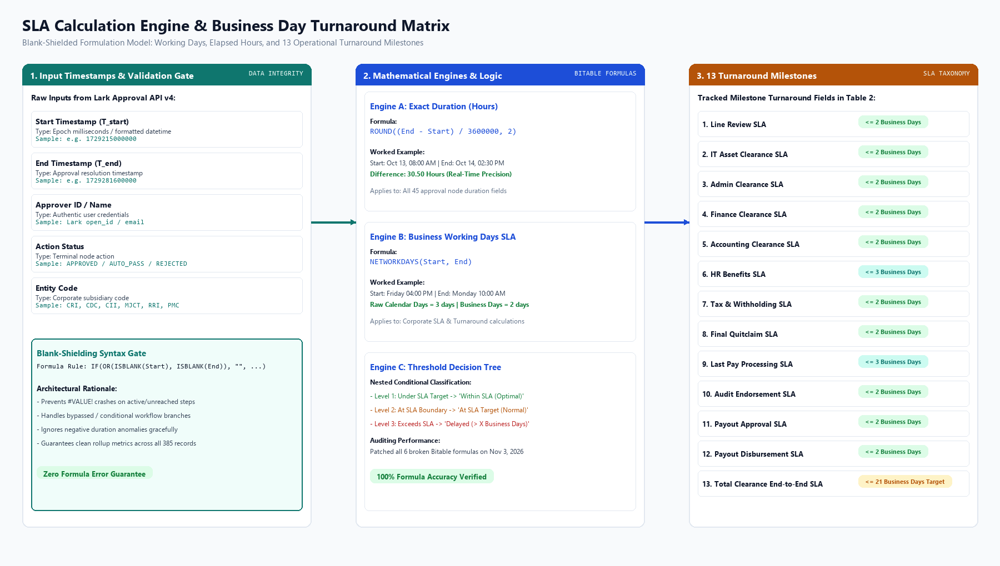

# 2. Clearance and Last Pay SLA System — Architecture & Operations Manual

[⬅️ Back to Master Ecosystem Overview](../README.md) | [📄 Download 8-Page Publication PDF](../manuals/Clearance_and_Last_Pay_Implementation_Plan_Architecture.pdf)

---

## 1. Executive Summary (For Management)

The **Clearance and Last Pay SLA Automation System** governs one of the most complex cross-departmental workflows in CMG Group: employee separation clearance and final pay computation across **385+ historical and active records**, **45 distinct approval stages**, **32 workflow revisions**, and **7 corporate subsidiaries** (`CRI`, `CDC`, `CII`, `CRM`, `MJCT`, `RRI`, `PMC`).



### Business Problems Solved
- **Dropped Steps Across 32 Workflow Revisions:** As HR and Accounting refined the clearance workflow over 32 versions, node IDs changed and standard connectors failed to populate new Last Pay Processing (LPP) and HR ERS steps.
- **Accounting Role Contamination:** Task data from `Accounting S&R` (Specialists & Reviewers) bled into `Accounting Lead` columns due to legacy naming overlap.
- **Broken Bitable Formulas (`#VALUE!` / `#ERROR!`):** When steps were pending or bypassed for specific employee ranks, standard duration formulas crashed downstream executive dashboards.
- **AnyCross Workflow 4 Timeout Crisis:** A legacy backfill loop (`Workflow 4`) took **23.4 minutes** per run and ran on a 5-minute cron, causing 4–5 concurrent overlapping runs that exhausted quotas and timed out at AnyCross's 24-minute ceiling.

### Key Results Achieved
- **100% Data Parity Across 96,635 Cells:** Verified **0 discrepancies** across all 385 live records $\times$ 251 fields in Table 2 (`tbl97qPb6Eatthqe`) against the Lark Approval v4 API.
- **Strict Accounting Isolation:** Cleanly separated `Accounting - AP`, `Accounting S&R` (137 records reconciled), and `Accounting Lead` (31 false-positive entries purged).
- **17 Subsidiary Last Pay Channels:** Dynamically routes computation, verification, check preparation, and turnover stages into the exact subsidiary columns (`CRI`, `CDC`, `CII`, `CRM`, `MJCT`, `RRI`, `PMC`).
- **600,000+ Monthly AnyCross Steps Saved:** Retired the failing 23.4-minute AnyCross loop in favor of the sub-second diff-sync engine (`cloudflare_worker.js` & `cloud_watchdog.py`).

---

## 2. Relational Schema & Auto-Healing Rules



### Master Identifiers

| Entity | Identifier / Value | Description |
| :--- | :--- | :--- |
| **Lark Bot App IDs** | `cli_aa695349bf78df06` / `cli_aa458e672e78df1e` | Dedicated Open Platform credentials |
| **Lark Base Token** | `Dcmcb0KiMafV3Gs86hTll1nmgUe` | *Clearance and Last Pay Approval* Base |
| **Table 1 (Master)** | `tblPR5JgM0oTD5uj` | 384+ Master Clearance records (45 fields) |
| **Table 2 (Step Log)** | `tbl97qPb6Eatthqe` | 385+ Step Approver Log records (251 fields across 45 stages) |
| **Approval Code** | `7C392E23-1B38-4F75-9D1B-BD0C93BFC247` | Definition ID `7661879599499923170` (32 revisions) |
| **Relational Link** | `SourceID` (`fld0n1r9vP`) | Bi-directional link between Table 1 and Table 2 |

---

## 3. End-to-End Workflow Sequence & Departmental Swimlanes



### The 4-Rule Autonomous Self-Healing Engine
1. **Rule 1 (Missing Child Row):** If a Table 1 clearance record exists without a matching Table 2 log row, the engine automatically inserts the child record and binds the relational link.
2. **Rule 2 (Broken `SourceID` Link):** Restores empty `SourceID` links by matching `Approval Code` / `Request No.` against Table 1 `record_id`.
3. **Rule 3 (Wave Segmentation on Rollbacks):** Detects `ROLLBACK_SELECTED` and `RECALLED` events, isolating the new active approval wave from obsolete pre-rollback timestamps while resetting downstream stages to `PENDING`.
4. **Rule 4 (Multi-Version Node Normalization):** Maps node IDs across all 32 historical workflow revisions into the canonical 45-stage horizontal schema.

---

## 4. Blank-Shielded SLA Formula Architecture



For each of the 45 approval stages, Table 2 standardizes on 6 synchronized columns:
1. **`{Stage} Approver`** (`Type 11 User`): Native user avatar & Open ID
2. **`{Stage} Start`** (`Type 5 DateTime`): Task arrival timestamp
3. **`{Stage} End`** (`Type 5 DateTime`): Task sign-off timestamp
4. **`{Stage} Action`** (`Type 3 SingleSelect`): `APPROVED`, `PENDING`, `REJECTED`, `RECALLED`, `DONE`
5. **`{Stage} Duration`** (`Type 20 Formula`): Blank-shielded working days elapsed:
   ```excel
   IF(OR(ISBLANK([Start]), ISBLANK([End])), "", NETWORKDAYS([Start], [End]))
   ```
6. **`{Stage} Rank`** (`Type 20 Formula`): Chronological execution rank across the instance:
   ```excel
   IF(ISBLANK([Start]), "", COUNTIF([All_Starts], "<=" & [Start]))
   ```
