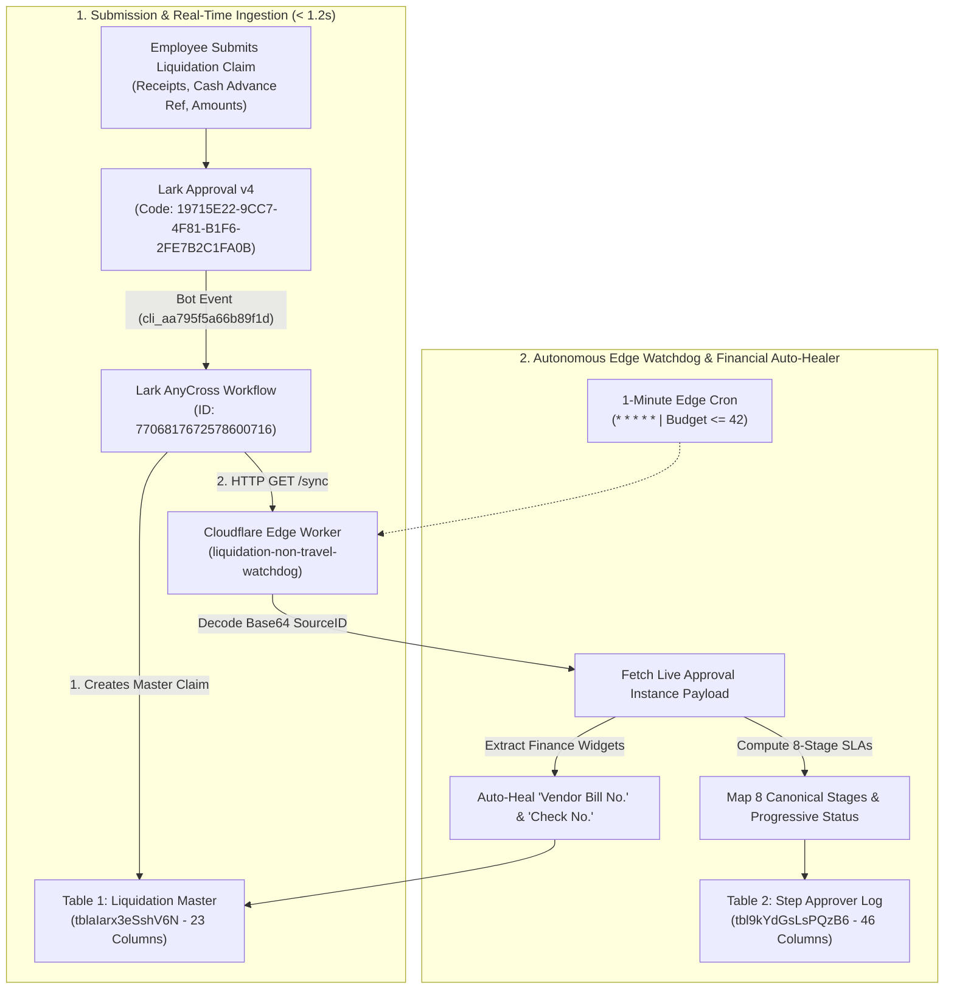

# 3. Liquidation (Non-Travel) — Architecture & Operations Manual

[⬅️ Back to Master Ecosystem Overview](../README.md)

---

## 1. Executive Summary (For Management)

The **Liquidation (Non-Travel) Automation System** streamlines the submission, departmental review, accounting verification, and treasury check release for non-travel cash advance liquidations and operational expense claims across CMG Group.

### Business Problems Solved
- **Schema Bloat from Multi-Table Breakdowns:** In earlier prototypes, adding a 3rd table for receipt line items created visual clutter for executives and caused cross-table lookup warning icons (`!`).
- **Missing ERP & Treasury Reference Numbers:** Accounting (`Vendor Bill No.`) and Treasury (`Check No.`) inputs are entered mid-workflow during approval—after the initial master row is created in Lark Base—leaving Table 1 blank unless manually copied.
- **Formula Lookup Write Locks (`ErrCode 1254045`):** Using Bitable `Type 19` cross-table formula lookups for `Task ID` and `Requester` produced evaluation warnings and blocked API updates.

### Key Results Achieved
- **Streamlined Strict 2-Table Architecture:** Permanently eliminated Table 3 by design. Table 1 (`Liquidation Master`) holds the financial summary and auto-healed ERP references, while Table 2 (`Step Approver Log`) tracks the **8 canonical approval stages** with clickable native `Task ID` links directly to the itemized approval form.
- **Automated Financial Control Healing:** The Cloudflare Edge Worker extracts `Vendor Bill No.` and `Check No.` entered by Accounting and Treasury during their approval steps and automatically heals them back into Table 1.
- **Sub-Second Hybrid Sync:** Combines an instant AnyCross webhook trigger (`< 1.2s`) with a 24/7 Cloudflare Edge Worker and a 1-minute cron safety net (`* * * * *`).

---

## 2. System Architecture & Lifecycle

---

## 3. Master System Identifiers

| Component | Identifier / Value | Notes |
| :--- | :--- | :--- |
| **Dedicated Lark Bot** | `cli_aa795f5a66b89f1d` | Released (`v1.0.2`); scoped to `bitable:app` & `approval:approval` |
| **Lark Base Token** | `PpBYbfebXalTOpsPThNlag60gef` | *Liquidation Non-Travel Master Tracker* (Strict 2-Table Base) |
| **Table 1 (Master)** | `tblaIarx3eSshV6N` | `Liquidation Master` (23 columns including financial controls) |
| **Table 2 (Step Log)** | `tbl9kYdGsLsPQzB6` | `Step Approver Log` (46 columns across 8 canonical stages) |
| **Approval Code** | `19715E22-9CC7-4F81-B1F6-2FE7B2C1FA0B` | *Liquidation (Non-Travel)* definition |
| **AnyCross Workflow** | `7706817672578600716` | Project `7706752931566980882` real-time ingestion flow |
| **Cloudflare Worker** | `liquidation-non-travel-watchdog` | `https://liquidation-non-travel-watchdog.markwilsongeronilla01.workers.dev` |

---

## 4. The 8 Canonical Approval Stages & Role Permissions

In Table 2 (`tbl9kYdGsLsPQzB6`), each of the **8 canonical stages** is tracked via 5 standardized columns (`Approver`, `Start`, `End`, `Duration`, `Action`), paired with a progressive `Overall Status` phase indicator:

| Stage # | Canonical Stage Name | Departmental Role & Form Field Governance |
| :---: | :--- | :--- |
| **1** | **Immediate Head** | Line supervisor review of receipt validity and expense purpose |
| **2** | **Department Head** | Departmental budget endorsement |
| **3** | **Treasury Verification of Deposit** | Verifies return/deposit of any excess cash advance balance |
| **4** | **Accounting Verification** | Audits Official Receipts (OR) / Invoices against liquidation totals |
| **5** | **Accounting Processing** | **Financial Control Gate 1:** `Vendor Bill No.` widget is **Editable & Required** here (Hidden during employee submission) |
| **6** | **Accounting Processing LD** | Secondary accounting review / ledger posting |
| **7** | **Treasury Processing** | **Financial Control Gate 2:** `Check No.` widget is **Editable & Required** here (Hidden during employee submission) |
| **8** | **Releasing of Check** | Final disbursement release to employee |

---

## 5. Key Architectural Decisions

1. **Why Table 3 Was Permanently Removed:**
   - Executive stakeholders preferred a clean 2-table layout without wide repeating slot columns. All repeating expense lines (`Receipt Date`, `Category`, `Merchant`, `OR No.`, `Amount`, `Attachment`) live natively inside the Lark Approval instance and are summarized in Table 1's `Detailed Liquidation` column.
2. **Zero `Type 19` Cross-Table Lookups:**
   - `Task ID` (`Type 15 URL`) and `Requester` (`Type 11 User`) in Table 2 are populated directly by the Cloudflare Worker rather than via Bitable lookup formulas, guaranteeing **zero orange `(!)` warning icons**.
3. **Automated CI Verification:**
   - Protected by **62/62 passing automated unit tests** (`test_cloudflare_worker_logic.js`) running on GitHub Actions CI.
