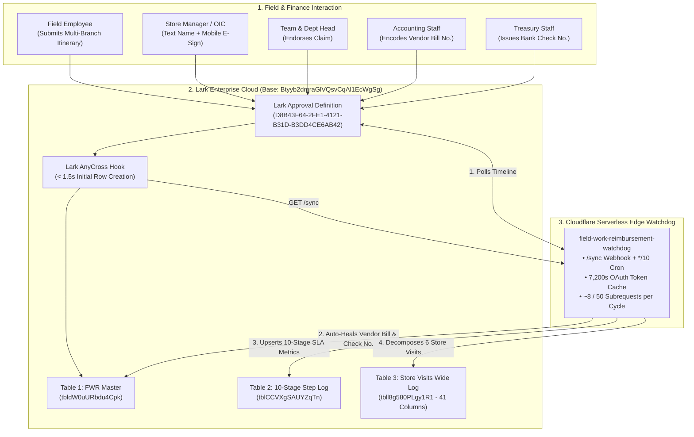

# 4. Field Work Reimbursement — Architecture & Operations Manual

[⬅️ Back to Master Ecosystem Overview](../README.md)

---

## 1. Executive Summary (For Management)

The **Field Work Reimbursement SLA Watchdog & Auto-Healer** automates the end-to-end reimbursement lifecycle for CMG Retail Inc. field technicians, store auditors, and roving operations staff who visit multiple retail branches (`CLN`, `So!Fab`, `CMG`, etc.) in a single trip.

### Business Problems Solved
- **Unstructured Multiline Store Itineraries:** When field staff logged 4 to 6 store visits on a single claim, Lark Approval exported the entire itinerary into one jammed semicolon-separated text cell in Table 1, making store-visit auditing nearly impossible.
- **Third-Party Mall / Store OIC Sign-Offs:** Field technicians frequently require store visit acknowledgments from branch OICs or mall supervisors who do not have individual corporate Lark accounts.
- **Delayed Financial Reference Sync:** Just like Liquidation, ERP `Vendor Bill No.` and bank `Check No.` values entered by Accounting and Treasury mid-workflow needed to be synced back to the master claim table automatically.

### Key Results Achieved
- **3-Table Dual-Engine Architecture:**
  - **Table 1 (`Field Work Reimbursement Form`):** Master claim overview and auto-healed ERP `Vendor Bill No.` & `Check No.`.
  - **Table 2 (`Step Approver Log`):** Tracks all **10 canonical approval stages** with pre-computed SLA durations (`< 1 min`, `2.5 hrs`, `1d 4h`).
  - **Table 3 (`Store Visits Log`):** A **41-column wide-table itinerary** that automatically decomposes up to **6 store visits per ticket** into structured columns (`Brand`, `Branch`, `Time In`, `Time Out`, `Purpose`, `Store Manager`).
- **Express `< 2000` Audit Path:** Supports both standard accounting routing and the express `Accounting Processing < 2000` node.

---

## 2. System Architecture & 3-Table Relational Schema

---

## 3. Master System Identifiers

| Component | Identifier / Value | Purpose |
| :--- | :--- | :--- |
| **Lark Bot App ID** | `cli_aa781b2415f89f1f` | Scoped to `bitable:app` and `approval:approval:readonly` |
| **Lark Base Token** | `Btyyb2dmraGlVQsvCqAl1EcWgSg` | *Field Work Reimbursement* 3-Table Base |
| **Table 1 (Master)** | `tbldW0uURbdu4Cpk` | `Field Work Reimbursement Form` (Master claims & financials) |
| **Table 2 (Step Log)** | `tblCCVXgSAUYZqTn` | `Step Approver Log` (10 canonical stages $\times$ 5 columns) |
| **Table 3 (Visits Log)**| `tbll8g580PLgy1R1` | `Store Visits Log` (6 wide visit slots = 41 columns) |
| **Approval Code** | `D8B43F64-2FE1-4121-B31D-B3DD4CE6AB42` | Field Work Reimbursement workflow definition |
| **Cloudflare Worker** | `field-work-reimbursement-watchdog` | `field-work-reimbursement-watchdog.markwilsongeronilla01.workers.dev` |

---

## 4. The 10 Tracked Approval Stages (Table 2)

| Stage # | Canonical Stage Name | Approval Node ID (`MD5`) | Stage Role |
| :---: | :--- | :--- | :--- |
| **1** | `Store Manager Sign-off` | `5584878fda1ab168a185663d6523be1f` | Branch verification & mobile signature |
| **2** | `Pre-Approval` | `95dba0f6adb33039d4f529324bcd7598` | Initial coordinator check |
| **3** | `Approval` | `cace3c7a87104e35a0b476a107e08735` | Operations management approval |
| **4** | `Team Head` | `cdab9cee83f7969bc24bfcdcdd33e8aa` | Immediate team lead endorsement |
| **5** | `Department Head (if none, enter requester name)` | `c1e48274b814fdce8dc77ddc6be0cd82` | Executive department endorsement |
| **6** | `Accounting Processing` | `b70952e34820509ebdfa2282eeacc24a` | Standard audit & ERP `Vendor Bill No.` encoding |
| **7** | `Treasury Processing` | `7b63029d8d0cde09d392185d545d6bf5` | Bank `Check No.` issuance |
| **8** | `Releasing of Check` | `fa30a3e3fabeffe257b4e50023bfe834` | Treasury check release |
| **9** | `Accounting Processing < 2000` | `a645282da1132673b810b34f4d51a054` | Express audit lane for claims under ₱2,000 |
| **10** | `Confirmation of Receipt` | `cef605e32a6190333bea6b051413a1b5` | Employee e-signature confirming receipt of funds |

---

## 5. Table 3 Schema: Wide-Table Store Visits Log (`tbll8g580PLgy1R1`)

Instead of fragmenting a single reimbursement claim into multiple child rows, Table 3 places up to **6 store visits side-by-side** in a single row per ticket:
- **Primary Keys & Native Links:** `Request No` (Text PK), `Approval Instance Code` (GUID), `Task ID` (Native `Type 15 URL`), `Requester` (Native `Type 11 User`).
- **Slot 0 (Visit 1):** `Brand`, `Branch`, `Time In`, `Time Out`, `Purpose`, `Store Manager`
- **Slots 1 to 5 (Visits 2 to 6):** `Brand (1)`..`Brand (5)`, `Branch (1)`..`Branch (5)`, `Time In (1)`..`Time In (5)`, `Time Out (1)`..`Time Out (5)`, `Purpose (1)`..`Purpose (5)`, `Store Manager (1)`..`Store Manager (5)`.
- **Verification:** Protected by **34/34 passing unit tests** (`test_cloudflare_worker_logic.js`).
