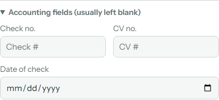
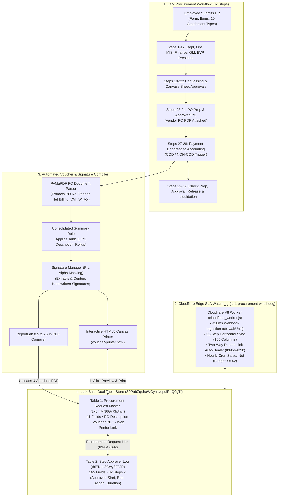

# 5. Procurement Automation & Disbursement Voucher Engine — Architecture Manual

[⬅️ Back to Master Ecosystem Overview](../README.md) | [📄 Download Procurement Architecture PDF](../manuals/Procurement_Request_System_Architecture_and_Handover_Guide.pdf)

---

## 1. Executive Summary (For Management)

The **Lark Procurement Automation & Disbursement Voucher Engine** bridges **Lark Procurement Approvals**, **Lark Base Dual-Table Tracking**, and **Accounting Check Disbursement Operations**. It tracks **32 cross-departmental approval steps** and automatically generates print-ready **$8.5 \times 5.5\text{ in}$ Half-Letter Disbursement Vouchers** complete with parsed vendor PO particulars, dynamic VAT/EWT tax calculations, and **authentic handwritten approver signatures**.

### Business Problems Solved
- **Manual Check Voucher Preparation:** Accounting staff previously spent 15–20 minutes per Purchase Request manually re-typing PO numbers, vendor names, tax breakdowns, and line items into spreadsheet voucher templates.
- **Multi-SKU Voucher Overflow:** Purchase Orders with 5–15+ item variations (e.g., multiple coffee flavors, sizes, or uniform SKUs) overflowed the physical $8.5 \times 5.5\text{ in}$ half-letter check voucher box.
- **Missing Authentic Signatures:** Standard digital prints lacked the actual handwritten signatures captured during Lark Approval sign-offs.
- **32-Step Visibility Gap:** Tracking where a PR was stuck across 32 possible departmental, canvassing, PO, and accounting nodes required manual inspection of the approval timeline.

### Key Results Achieved
- **Automated $8.5 \times 5.5\text{ in}$ PDF & Interactive HTML5 Canvas Printer:** Automatically attaches a timestamped PDF voucher to Table 1 (`Voucher PDF Attachment`) and provides a 1-click web printer (`Voucher Request Link`) where Accounting can type `Check #`, `CV #`, and `Check Date` and print immediately.
- **Multi-Tier Vendor PO PDF Parser (`PyMuPDF`):** Reads attached vendor PO PDFs directly from Lark to extract PO numbers, suppliers, subtotals, VAT, and WTAX.
- **The Consolidated Summary Rule (`PO Description`):** Rolls up multi-SKU POs into a single clean summary line on the physical voucher while preserving full itemized lines in the audit payload.
- **Authentic Handwritten Signatures Vault:** Extracts approver signatures from Lark Approval tasks, strips white backgrounds via `Pillow` alpha masking, and center-aligns them over the signatory lines.

---

## 2. End-to-End System Architecture

---

## 3. Master System Identifiers

| Entity | Identifier / Value | Notes |
| :--- | :--- | :--- |
| **Lark Bot App ID** | `cli_aa695349bf78df06` | *Procurement Operations Bot* (Bitable, Approval, Drive scopes) |
| **Lark Base Token** | `S0PabZqchaWCyhsvopulRnQ0gTf` | *Procurement Request* Dual-Table Base |
| **Table 1 (Master)** | `tbldmMN6GyXbJhvr` | `Procurement Request - Copy` (41 standardized fields) |
| **Table 2 (Step Log)** | `tblEKpe8Gwy8FJJP` | `Step Approver Log` (165 fields across 32 approval steps) |
| **Approval Code** | `DE7A4D9F-50FD-44B5-AFE9-16585BA2F8EF` | Definition ID `7702009651606703888` |
| **Duplex Link Field** | `fld95s9B9k` | `Procurement Request Link` (Two-way relation between T1 & T2) |

---

## 4. The 32 Standardized Approval Steps (Table 2: `tblEKpe8Gwy8FJJP`)

Each step in Table 2 tracks 5 columns (`Approver`, `Start`, `End`, `Action`, `Duration`):

| Phase | Step Numbers & Canonical Names |
| :--- | :--- |
| **Phase 1: Line & Executive Approvals (1–17)** | `1. Team Head` $\rightarrow$ `2. Department Head` $\rightarrow$ `3. Division Head` $\rightarrow$ `4. Store Operations` $\rightarrow$ `5. HR` $\rightarrow$ `6. Warehouse` $\rightarrow$ `7. Loss Prevention` $\rightarrow$ `8. Audit` $\rightarrow$ `9. Merchandising` $\rightarrow$ `10. Marketing` $\rightarrow$ `11. Visual Merchandising` $\rightarrow$ `12. MIS Approval 1` $\rightarrow$ `13. MIS Approval 2` $\rightarrow$ `14. Finance` $\rightarrow$ `15. General Manager` $\rightarrow$ `16. Executive Vice President` $\rightarrow$ `17. President` |
| **Phase 2: Purchasing & Canvassing (18–22)** | `18. Canvass Sheet Form Preparation` $\rightarrow$ `19. Canvass Sheet Verification & Summary Approval` $\rightarrow$ `20. Canvassing` $\rightarrow$ `21. Approved Canvass Sheet Approval` $\rightarrow$ `22. Approved Canvass Sheet Form Preparation` |
| **Phase 3: Purchase Order & Delivery (23–25)** | `23. Purchase Order Preparation` $\rightarrow$ `24. Approved PO` *(Vendor PO PDF attached here)* $\rightarrow$ `25. Delivery / Job Completion` |
| **Phase 4: Accounting & Check Disbursement (26–32)** | `26. Preparation of Request for Payment` $\rightarrow$ `27. Payment Endorsed to Accounting (COD)` $\rightarrow$ `28. Payment Endorsed to Accounting (NON-COD)` *(Triggers Voucher PDF compilation)* $\rightarrow$ `29. Preparation of Check & Voucher` $\rightarrow$ `30. Approval of Check & Voucher` $\rightarrow$ `31. Check Release / Transfer of Funds` $\rightarrow$ `32. Liquidation Form Preparation` |

---

## 5. Disbursement Voucher Financial & Signature Rules

1. **Dynamic Tax & Net Payable Formula:**
   $$\text{Net Billing} = \text{Parsed PO Subtotal (or Table 1 Total Cost)}$$
   $$\text{VAT (12\%)} = \text{Net Billing} \times 0.12 \quad \big| \quad \text{Expanded WTAX (2\%)} = \text{Net Billing} \times 0.02$$
   $$\text{Net Payable} = \text{Net Billing} + \text{VAT} - \text{WTAX}$$
2. **Consolidated Summary Rule (`PO Description`):**
   - **If `PO Description` is provided in Table 1** (e.g., `"Various Coffee Items"`): Renders 1 clean line with that description and rolls up the total billing under the PO #.
   - **If `PO Description` is blank in Table 1**: Leaves the description cell intentionally blank (`""`) while rolling up the total billing into 1 clean row under the PO #.
3. **Verification Suite:**
   - Validated by **327/327 passing automated tests** (`test_cloudflare_worker_logic.js`).
