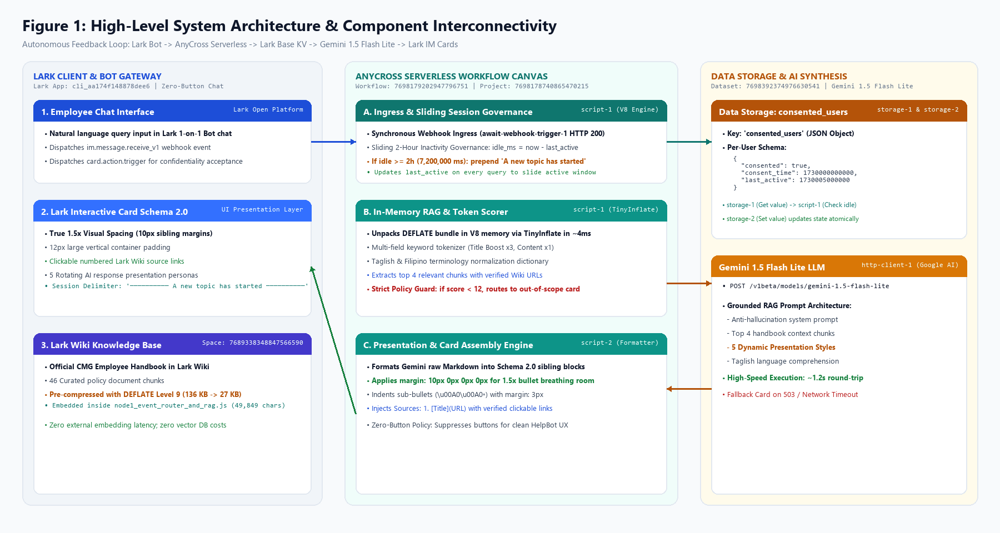
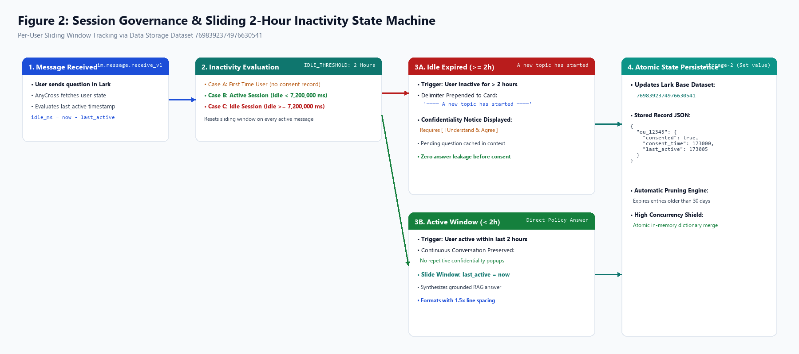
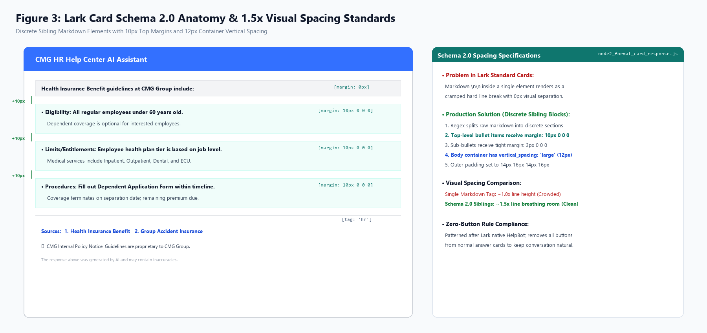
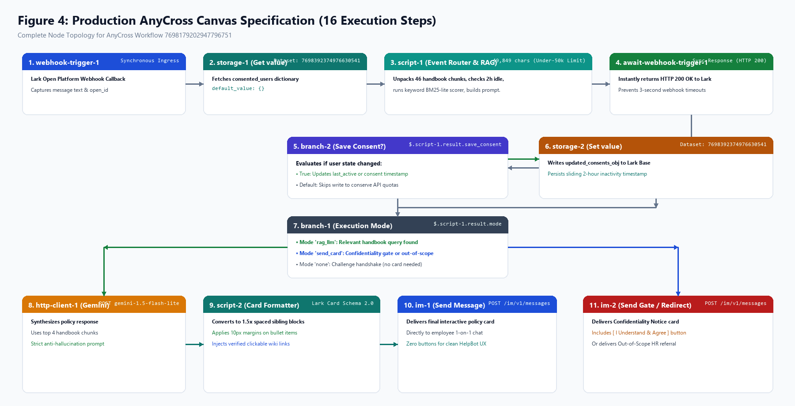

# 6. CMG HR Help Center AI Assistant — Architecture & Operations Manual

[⬅️ Back to Master Ecosystem Overview](../README.md) | [📄 Download 8-Page Technical Manual PDF](../manuals/CMG_HR_Help_Center_AI_Assistant_Technical_Manual.pdf)

---

## 1. Executive Summary (For Management)

The **CMG HR Help Center AI Assistant** (`cli_aa174f148878dee6`) is an autonomous, 24/7 conversational AI chatbot embedded directly inside **Lark Messenger**. Patterned after Lark's official Help Center AI Assistant, it answers employee HR policy questions in **English, Filipino, and Taglish** with 100% grounded citations from the **46 official policy documents** in the **CMG Employee Handbook** (Lark Wiki Space `7689338348847566590`).

### Business Problems Solved
- **Repetitive HR Policy Inquiries:** HR Total Rewards (TR) and Employee Relations (ER) teams spent significant daily hours answering recurring questions on leave entitlements, HMO coverage, loan eligibility, overtime cut-offs, and government benefits.
- **Unprotected Policy Access & Night-Shift Lockouts:** Early bot versions either lacked confidentiality gating or used a fixed 8:00 AM – 5:00 PM PHT clock that locked out night-shift E-Commerce/Logistics staff after 5:00 PM.
- **AnyCross 50,000-Character Script Ceiling:** Embedding 136 KB of raw handbook text directly into an AnyCross JavaScript node failed with `js_code parameter exceeds maximum length of 50000 characters`.
- **Squashed Wall-of-Text Cards:** Standard Lark Markdown renders `\n\n` as tight 0px breaks, making long policy answers difficult to read on mobile.

### Key Results Achieved
- **In-Memory DEFLATE Level-9 RAG Engine (`49,849 / 50,000` chars):** Compresses all 46 handbook policy documents (136 KB raw) into a 27 KB Base64 binary bundle that decompresses in V8 memory in **~4ms** using `tiny_inflate.min.js`—requiring zero external vector databases.
- **Sliding 2-Hour Inactivity Confidentiality Gate (`7,200,000 ms`):** Operates 24/7 across all shifts. Employees agree once to the CMG Confidentiality Clause and chat freely; if idle for $\ge 2\text{ hours}$, the bot displays `────────── A new topic has started ──────────` and re-prompts the Confidentiality Notice before answering.
- **True 1.5x Visual Spacing (Lark Card Schema 2.0) & Zero-Button UX:** Emits each bullet point as an independent sibling element (`margin: "10px 0px 0px 0px"`) with clickable numbered Wiki citations and zero clutter buttons on answer cards.

---

## 2. Sliding 2-Hour Session Governance

### How State Persistence Works in Stateless Cloud Isolates
Because AnyCross JavaScript nodes execute in ephemeral V8 isolates, user consent and activity timestamps are persisted in **AnyCross Native Data Storage** (`Dataset: 7698392374976630541`, Key: `consented_users`):
1. **Active Inquiry (`curMs - lastActive < 7,200,000 ms`):** Immediately refreshes the user's timestamp (`touchUserActivity`), runs RAG search over the 46 handbook chunks, calls **Google Gemini 1.5 Flash Lite**, and returns the grounded answer card.
2. **First-Time or Expired Session (`>= 7,200,000 ms`):** Holds the user's question inside `button.value.pending_query` (keeping `button.name` fixed at 25 characters `"agree_confidentiality_btn"` to prevent Lark `ErrCode 11310`) and presents the Confidentiality Notice card. Once the user clicks `[✅ I Understand & Agree]`, the bot automatically answers their original question!

---

## 3. Lark Card Schema 2.0 Visual Spacing & Persona Rotation

### 5-Persona Anti-Repetition Engine
To ensure repeated questions never feel robotic, `script-1` rotates across **5 presentation styles** while keeping facts 100% strictly grounded in the handbook:
1. *Eligibility, Limits, and Procedures Grouping*
2. *Direct 1–2 Sentence Answer with Bulleted Specifics*
3. *Official Provisions Overview with Rules, Amounts, and Schedules*
4. *Requirements, Covered Items, and Filing Steps*
5. *Scannable Summary with Bold Lead-in Labels*

### Indexed Policy Coverage (46 Official Wiki Documents)
| Policy Category | Docs | Covered Topics |
| :--- | :---: | :--- |
| **Confidentiality Clause** | 1 | NDA, proprietary guidelines protection, compliance sanctions |
| **HR TR — Employee Benefits & Allowances** | 16 | Salary/Emergency Loans, HMO, Accident Insurance, Birthday Benefits, Rice Subsidy, Wedding Gift, Bereavement, Vacation & Sick Leave (2026 Entitlements), Payroll, Per Diem, Mileage, Extended Work Allowance |
| **HR TR — Timekeeping Policies** | 6 | Work Schedules, Attendance Cut-offs, Grace Periods, Overtime, Tardiness across Office (EXO, Commercial, SSG), Non-Office, Supply Chain & E-Commerce |
| **HR TR — Government Benefits** | 8 | SSS Maternity (105/120d), SSS/Pag-IBIG Loans, Paternity (7d), Solo Parent (7d), Magna Carta for Women (60d), VAWC Leave (10d) |
| **HR ER — Code of Conduct** | 15 | Workplace Professionalism, Attendance Violations, Insubordination, Disciplinary Sanctions, Due Process |

---

## 4. Production AnyCross 16-Node Canvas Pipeline

| Parameter | Production Value |
| :--- | :--- |
| **Lark Bot App ID** | `cli_aa174f148878dee6` ([1-Click Direct Chat Link](https://applink.larksuite.com/client/bot/open?appId=cli_aa174f148878dee6)) |
| **AnyCross Project ID** | `7698178740865470215` (*CMG HR Employee Handbook Bot*) |
| **AnyCross Workflow ID** | `7698179202947796751` (*HR Employee Handbook Bot* — 16 execution nodes) |
| **Data Storage Dataset** | `7698392374976630541` (Key: `consented_users`) |
| **Lark Wiki Space ID** | `7689338348847566590` (*CMG Employee Handbook*) |
| **AI Model** | Google Gemini 1.5 Flash Lite (`gemini-flash-lite-latest`) |
| **Automated QA Suite** | **65 / 65 Passing Assertions** (`node test_lark_help_center.js`) |
